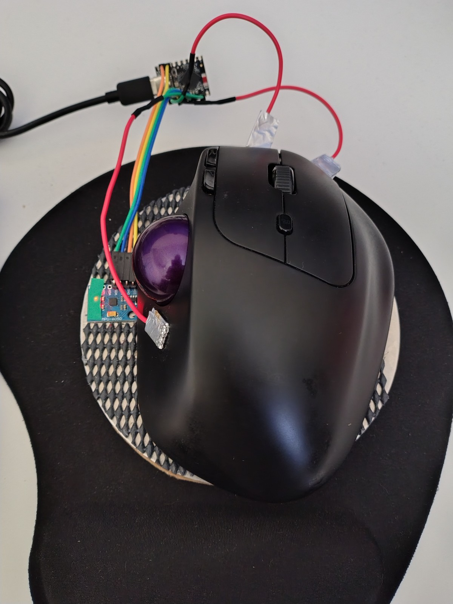
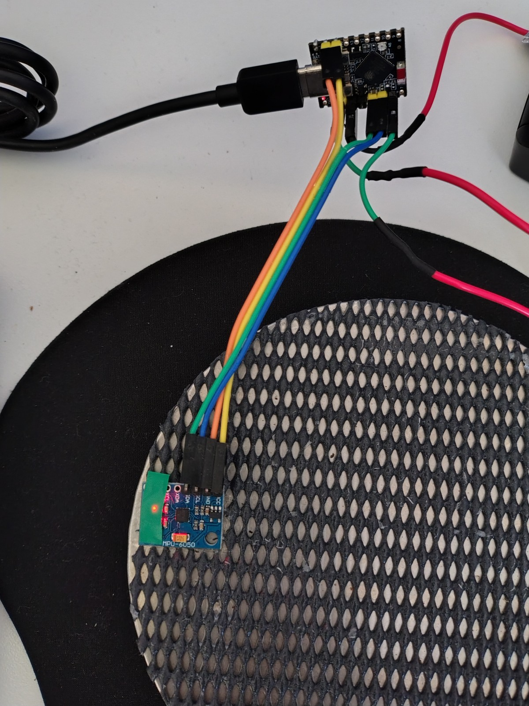
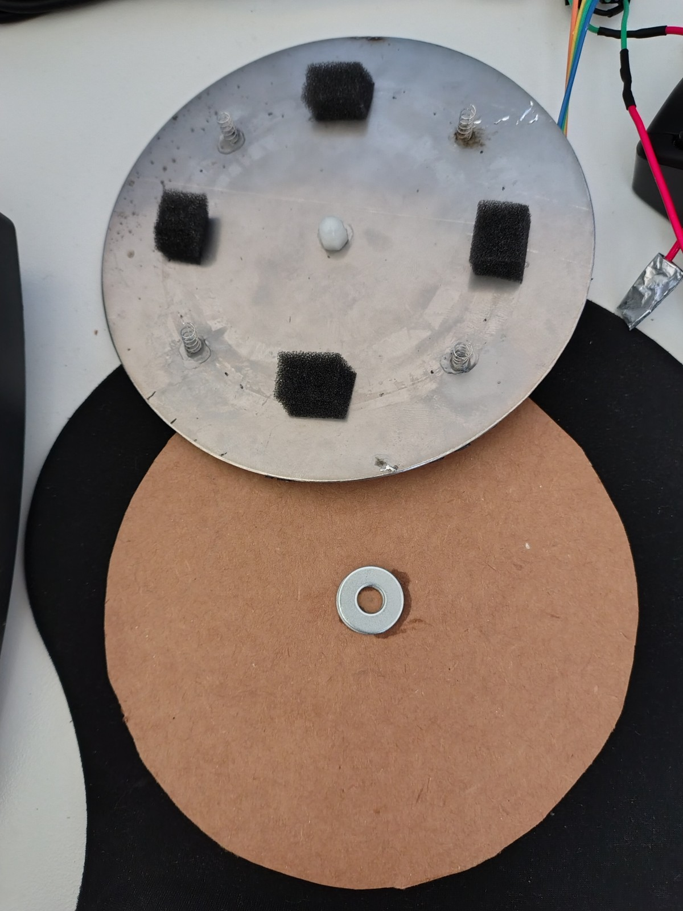

# Gyroscopic Mouse Base

This is the build and design of a gyroscopic mouse base. The base is suitable to
place any mouse on top and operates as an additional tilt-to-move pointer. The
base is fully plug-and-play, requiring no extra drivers or operating system
software to use.

The target audience of this mouse base is anyone attempting to reduce repetitive
strain injury (RSI) from mouse movement, or those wishing to be proactive about
managing potential long-term injury from mouse use. While trackball mice (those
where a ball is under the thumb or fingers) are also good for reducing RSI,
these mice may not suit all users and generally have different features. If you
want to keep your ultra flash double scroll wheel RGB LED mouse and still reduce
your risk of RSI, then this is for you.

This project is not recommended for gaming, however. Based on my understanding,
the requirements for fast gaming response and precise movement will likely not
be met with this project. You can, however, park your gaming mouse on this base
for office use, and simply lift it off when it is time to game.

## Images

Images of a prototype design are shown below. While a more thorough design could
include proper casing and make sure connectors are not exposed, I personally
don't mind the cyber-punk exposed electronics look.

Note: I used a trackball mouse during testing and did not require the
back/forward buttons which are optional.

## Using

Using the mouse is rather simple. A touch sensor sits under the thumb to engage
and disengage the tilt sensor. This is most useful to make sure a physical click
of the mouse is not accidentally registered as a tilt. The thumb touch sensor is
also used to double the speed (double tap and hold), along with a re-tare of the
centre point (triple tap). Auxiliary touch pads on the mouse click tips provide
effortless Back and Forward navigation without shifting your grip. The onboard
LED of the microcontroller provides visual feedback for touch. While it takes a
bit of getting used to since moving a mouse and tilting a mouse are not the
same, after about 2 weeks you will have this mastered. Since you can bring your
own existing mouse, you can easily switch between tilting and traditional
sliding as needed.

## Getting Started - Building

Still interested? Look at [the design](DESIGN.md) for more information, followed
by [building & tuning](BUILD%20and%20TUNING.md) for detailed build and
configuration instructions.
